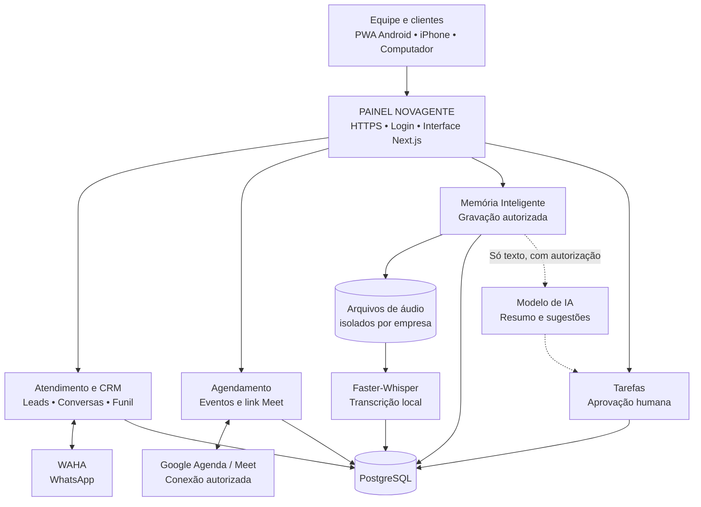

# NOVAGENTE ATENDIMENTO COM AGENDAMENTO

**PAINEL NOVAGENTE** — atendimento WhatsApp, oportunidades, agenda e memória inteligente de reuniões.

## Sinopse do produto

O **NOVAGENTE ATENDIMENTO COM AGENDAMENTO** é um painel que conecta a jornada de um cliente — **mensagem, atendimento, oportunidade, compromisso e acompanhamento** — em um mesmo lugar. A equipe pode registrar reuniões autorizadas, obter a transcrição local e transformar decisões em tarefas revisadas, sem perder o histórico comercial.

A ideia é simples: **uma conversa não termina quando o cliente para de falar; ela continua até o que foi combinado acontecer.**

A imagem acima mostra a relação entre as áreas. Os recursos externos, como Google Agenda/Meet e modelos de IA, exigem configurações e autorizações próprias. A gravação é feita pela NOVAGENTE de forma independente da função nativa de gravação do Meet.

**Leia a [sinopse completa, explicada módulo por módulo](docs/SINOPSE.md), ou abra o [organograma técnico editável](docs/ARQUITETURA.md).**

## Atendimento integrado

O atendimento reúne **Novo contato, Em atendimento, Qualificado, Perdido e Cliente conquistado** diretamente na conversa, com nome editável, histórico interno por atendente e agendamento vinculado ao cliente. **Contatos** apresenta o funil visual; **Agenda** reúne calendário e Memória Inteligente.

[Conheça o novo fluxo de atendimento definido com Thaís](docs/FLUXO-ATENDIMENTO-THAIS.md).

## Organograma da arquitetura

Visualização direta no GitHub. Veja o [organograma completo e os fluxos técnicos](docs/ARQUITETURA.md).

## O que está implementado

- WhatsApp conectado via WAHA (sessão individual), CRM, contatos, oportunidades e indicadores;
- Agenda interna com conectores de videoconferência existentes (dependem da autenticação de cada conta);
- **Memória Inteligente** na rota /memoria: gravação pelo navegador (microfone ou áudio de aba em navegador compatível), importação de áudio, vínculo com compromissos, histórico e reprodução;
- Transcrição local com Faster-Whisper CPU pelo serviço Docker opcional meeting-worker;
- Classificação básica offline e análise de decisões, objeções e tarefas via provedor de IA configurado quando houver autorização explícita;
- Aprovação humana de tarefas e atualização do andamento.

## Implantação

1. Configure os segredos e APP_BASE_URL em .env.waha (não versionar).
2. CRM e WAHA: docker compose --env-file .env.waha -f compose.waha-standalone.yml up -d --build
3. Transcritor local: docker compose --env-file .env.waha -f compose.waha-standalone.yml --profile transcription up -d --build meeting-worker
4. Cadastre o administrador. Conecte WAHA e Google Agenda (se quiser links Meet) por organização.
5. Para captar áudio do Meet, compartilhe uma aba com áudio via navegador compatível. A gravação é independente das funções pagas de gravação do Google.

Veja docs/MEMORIA-INTELIGENTE-NOVAGENTE.md e docs/WAHA-NOVAGENTE.md.

## Segurança e limites

Login obrigatório, arquivos por organização, autorização registrada para gravação e confirmação antes de transmitir transcrições a modelos de IA externos. Limite atual 40 MB. A transcrição local não cria tarefas inventadas: a análise semântica precisa de um modelo configurado e consentimento. A identificação nominal dos participantes, o bot autônomo que entra em chamadas e a retenção/exclusão completa são fases seguintes, não disponíveis agora. Cumpra as regras do Meet e a LGPD.

## Origem e licença

Produto independente NOVAGENTE construído a partir da base open source Vocero CRM (https://github.com/kevinrivm/vocero-crm). A licença MIT e os créditos originais permanecem no arquivo LICENSE. Não há parceria com os autores da base.

### Outras plataformas

Os arquivos históricos de implantação [Render](render.yaml), [Fly.io](fly.toml) e [Railway](railway.toml) estão preservados como referências técnicas. Para a NOVAGENTE com WAHA e transcrição use o Compose independente descrito acima.

## Instalação como aplicativo (PWA)

Android, iPhone e computador podem instalar o PAINEL NOVAGENTE via HTTPS. Consulte o [guia de instalação](docs/PWA.md). Por segurança, conversas, reuniões e gravações não são armazenadas para acesso offline.
