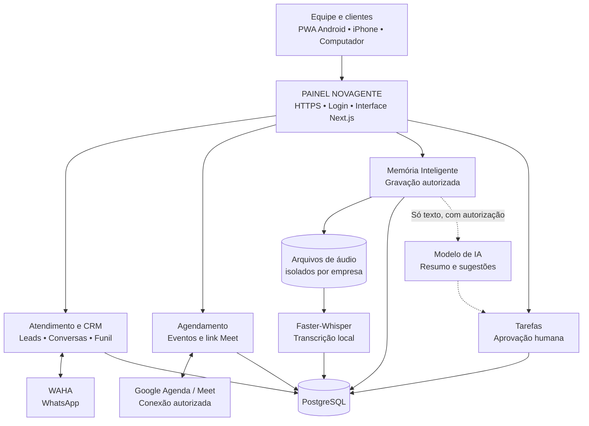
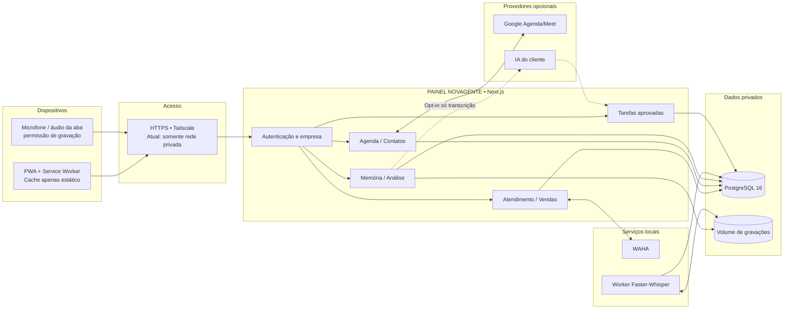

# Arquitetura — NOVAGENTE ATENDIMENTO COM AGENDAMENTO

Diagrama de arquitetura renderizado pelo GitHub usando Mermaid. Representa a implementação e suas integrações opcionais, sem confundir recursos prontos com planejados.

## Organograma geral

## Organograma técnico por camadas

## Fluxos operacionais

### Atendimento e agenda
1. WhatsApp chega pelo WAHA; o webhook assinado registra contatos e conversas no CRM.
2. A equipe classifica a oportunidade e realiza agendamento pelo módulo Agenda.
3. O link Google Meet depende de autorização e configuração do conector Google do cliente; não é criado sem credenciais.

### Gravação, transcrição e tarefas
1. Participantes são informados, o operador confirma autorização e inicia gravação ou importa áudio.
2. A API autenticada verifica arquivo e empresa, salva o áudio no volume privado e os metadados no PostgreSQL.
3. Faster-Whisper faz a transcrição local. A IA remota recebe somente texto com autorização do usuário.
4. As propostas de ação viram tarefas somente após aprovação humana.

### PWA e privacidade
- App instalável via HTTPS; mantém autenticação e permissões por empresa.
- Service worker guarda só tela pública offline e arquivos estáticos versionados.
- Nada de respostas de API, HTML autenticado, contatos, agendas, gravações ou transcrições em cache offline.
- O PWA usa a mesma aplicação Next.js; não é um segundo banco de dados.

## Onde fica cada componente

| Camada | Código |
|---|---|
| PWA | public/manifest.webmanifest, public/sw.js, src/components/pwa |
| CRM | src/app/(app), src/server/inbox |
| WhatsApp | src/server/waha, src/app/api/webhooks/waha |
| Agendamentos | src/server/agenda, src/app/(app)/bookings |
| Memória | src/app/(app)/memoria, src/app/api/meeting-memory |
| Transcrição | services/meeting-worker, Dockerfile.meeting-worker |
| Banco e migrações | src/lib/db/schema.ts, drizzle |
| Implantação | compose.waha-standalone.yml |

## Limites conhecidos

**Em funcionamento na arquitetura:** painel CRM, integração técnica WAHA, agenda, gravação autorizada via navegador, importação de áudio, memória e tarefas aprovadas; worker de transcrição separado.

**Necessita configurar por cliente:** pareamento do WhatsApp, conta Google autorizada para evento e link Meet, provedor de IA e consentimento para análise externa.

**Planejado:** bot que entra em reuniões, identificação nominal de vozes, push de tarefas, retenção/apagamento automatizados e acesso público com domínio e políticas para clientes. O repositório continua privado até decisão do proprietário.

Consulte [PWA](PWA.md) e [Memória Inteligente](MEMORIA-INTELIGENTE-NOVAGENTE.md).
