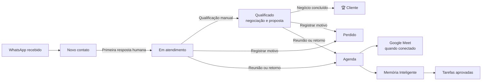

# Fluxo de atendimento NOVAGENTE — revisão com Thaís

## Objetivo

Colocar todas as decisões comerciais **dentro do Atendimento** e deixar o histórico do cliente disponível para qualquer pessoa que assuma a conversa.

## Jornada do cliente

## Atendimento

- Novo contato: primeira mensagem chega e fica na primeira fase.
- Em atendimento: a **primeira resposta humana enviada pelo painel** move Novo contato para Em atendimento, usando a mesma trilha de auditoria que o funil antigo. Novas mensagens não movem uma conversa que já está em outra fase.
- Qualificado: a equipe escolhe quando está negociando ou avaliando uma proposta.
- Perdido: a equipe escolhe o motivo, inclusive parou de responder. Não há prazo de inatividade automático, pois esse SLA ainda precisa ser definido.
- Cliente conquistado: fase de negócio fechado, sinalizada por troféu. O histórico original é mantido.
- Todos os filtros ficam no Atendimento. A lista mantém notificações de novas mensagens em cada fase.

## Histórico que acompanha o contato

- Nome editável manualmente, visível para os próximos atendentes.
- Mensagens originais preservadas na conversa.
- Resumo livre atualizado para a próxima pessoa da equipe.
- Histórico cumulativo, com data, autor e assunto: simulação, orçamento, necessidade, dúvida, retorno e geral.
- Novas notas não substituem registros anteriores. Elas são armazenadas por empresa na tabela contact_service_note.

## Agendamentos

Dentro do painel de detalhes da conversa, a equipe pode escolher reunião, retorno ou atendimento presencial. O sistema mostra os horários livres de um dia e reserva no calendário, vinculado ao contato e à conversa. A criação de link Meet depende da autorização e configuração da conta Google.

A Agenda continua em calendário visual por dia, semana, mês ou lista, com a Memória Inteligente integrada na mesma seção. A gravação depende da permissão explícita no navegador ou de arquivo importado; **não existe bot autônomo gravando automaticamente o Google Meet nesta versão**.

## Contatos

Contatos tem visualização em funil por fase e visão em lista. Fases antigas são preservadas em uma coluna adicional, para não esconder registros legados.

## Menu

- Visão geral
- Atendimentos
- Contatos
- Agenda (com Memória Inteligente)
- Ferramentas de IA e Indicadores nas seções correspondentes

O antigo endereço /pipeline redireciona para o funil de Contatos; /memoria redireciona para a Memória dentro da Agenda. Os endpoints e as tabelas anteriores continuam preservados.

## Observações

Nenhum contato é marcado como perdido automaticamente por silêncio. Todas as gravações exigem consentimento. A criação de eventos Google Meet precisa de credenciais autorizadas por cliente, e a transcrição é local via Faster-Whisper.

Esta mudança reorganiza o produto sem apagar o banco de dados ou histórico das conversas.
