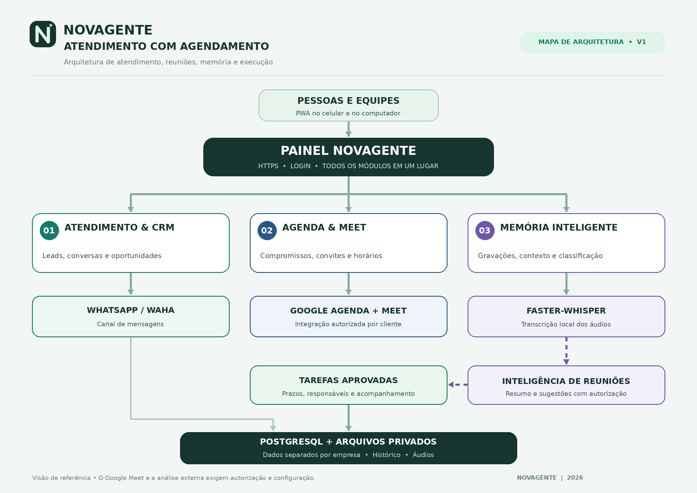

# Sinopse — NOVAGENTE ATENDIMENTO COM AGENDAMENTO

## A ideia em poucas palavras

**Um painel para acompanhar o cliente desde a primeira mensagem até a execução do que foi combinado.**

O **PAINEL NOVAGENTE** reúne atendimento, relacionamento comercial, compromissos, gravação autorizada de reuniões, transcrição, classificação e acompanhamento de tarefas. Em vez de espalhar informações entre aplicativos e depender da memória das pessoas, a equipe encontra o histórico e as próximas ações em um único ambiente.

> **Leitura rápida do mapa:** as pessoas acessam o PAINEL NOVAGENTE pelo celular ou computador. No centro há três áreas de trabalho: **Atendimento & CRM**, **Agenda & Meet** e **Memória Inteligente**. O WhatsApp (WAHA), o Google Agenda/Meet e o transcritor local são recursos conectados a essas áreas. A IA organiza o entendimento das conversas, enquanto as tarefas exigem aprovação humana. O PostgreSQL e os volumes de arquivos guardam as informações separadas por organização.

## Qual problema ele procura resolver?

Uma empresa recebe mensagens, identifica potenciais clientes, marca reuniões e combina ações — mas frequentemente perde contexto entre um momento e outro. Uma proposta fica esquecida; o responsável não sabe o que ficou decidido; uma reunião termina sem plano de ação.

A proposta da NOVAGENTE é conectar essas etapas para que cada conversa tenha continuidade: **entender, registrar, agendar, analisar e acompanhar**.

## O que cada módulo faz

### 1. Atendimento & CRM
É a porta de entrada do relacionamento. Organiza mensagens recebidas pelo WhatsApp através da integração WAHA, contatos, histórico, oportunidades e etapas comerciais. Serve para saber **quem procurou a empresa, o que pediu e em que ponto do relacionamento está**.

### 2. Agenda & Meet
Concentra compromissos de atendimento, apresentações e reuniões. Quando uma conta Google estiver devidamente conectada e autorizada, o módulo poderá criar eventos e obter links de videoconferência pelo conector já existente. O calendário ajuda a evitar esquecimentos e a relacionar compromissos a contatos.

### 3. Memória Inteligente
Permite capturar áudio pelo navegador, com permissão explícita, ou importar uma gravação autorizada. Os arquivos ficam associados à empresa e, quando escolhido, a um compromisso. O transcritor local **Faster-Whisper** converte o áudio em texto, sem depender da gravação nativa do Google Meet.

A transcrição pode ser revisada. Quando o usuário autoriza a análise via provedor de IA configurado, o sistema sugere resumos, classificações, decisões e próximas tarefas. Sem isso, a classificação preliminar local é limitada: **não deve inventar decisões que não foram ditas**.

### 4. Tarefas e execução
Depois de analisar uma conversa, a equipe decide quais sugestões se tornam tarefas. Essas atividades podem ter acompanhamento de andamento. A inteligência **não assume compromissos nem envia avisos para terceiros sem confirmação**.

### 5. Base de dados e privacidade
O PostgreSQL concentra as informações operacionais, e os arquivos de áudio ficam em volumes próprios. A API exige autenticação e restringe dados à organização correspondente. O PWA pode ser instalado, mas seu cache offline não salva dados de clientes, gravações ou mensagens.

## Exemplo de jornada

Uma pessoa chama a empresa no WhatsApp para conhecer um serviço. O atendimento abre ou atualiza o contato e identifica uma oportunidade. A equipe marca uma reunião de diagnóstico. Durante essa reunião, com os participantes informados, um operador grava o áudio pelo navegador. O transcritor transforma a conversa em texto. A IA, quando autorizada, identifica que o cliente solicitou uma proposta. A equipe revisa essa evidência e aprova uma tarefa para preparar a proposta.

**O benefício não está só em gravar: está em impedir que o contexto e os compromissos se percam entre as etapas.**

## O que está pronto e o que não está

| Situação | Recurso |
|---|---|
| Implementado na base | PWA instalável, painel de CRM, integração técnica WAHA, agenda interna, Memória Inteligente, upload/captura de áudio, transcrição local e tarefas com aprovação humana |
| Requer configuração e autorização | Pareamento da conta WhatsApp, Google Calendar/Meet de cada cliente, provedor externo de IA e consentimento para analisar texto |
| Previsto para evolução | Bot participante automático, diarização nominal de falantes, notificações e delegação avançada, políticas completas de retenção e exclusão, operação offline com dados transacionais |

O repositório contém a implementação e a documentação, mas **não representa aprovação automática para gravações**. Toda captura precisa respeitar os participantes, as regras das plataformas e a legislação aplicável, incluindo a LGPD.

## Para quem é essa documentação?

- **Gestores e clientes:** esta sinopse explica o objetivo e a jornada do produto.
- **Comercial:** a imagem facilita apresentar o sistema sem expor detalhes técnicos.
- **Desenvolvedores:** o [organograma de arquitetura](ARQUITETURA.md) documenta camadas, serviços, dados e integrações.
- **Equipe de implantação:** o [guia PWA](PWA.md) e o [guia da Memória Inteligente](MEMORIA-INTELIGENTE-NOVAGENTE.md) explicam configuração e limites.

### Materiais de referência

- [Imagem de arquitetura em PNG](assets/arquitetura-novagente-atendimento-agendamento.png)
- [Fonte Mermaid do organograma resumido](diagramas/organograma-resumido.mmd)
- [Organograma editável em Mermaid + arquitetura técnica](ARQUITETURA.md)
- [Guia do aplicativo PWA](PWA.md)
- [Guia da Memória Inteligente](MEMORIA-INTELIGENTE-NOVAGENTE.md)
